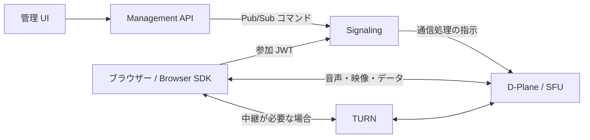

# 目的・提供範囲・全体構成

## 前提

- ブラウザーから同じルームに参加し、音声・映像・データを送受信する。
- 通話はすべて SFU を経由する。P2P 通話は対象外とする。
- 1 ルームの同時参加人数は 100 人を目標とする。
- 全員がマイク・カメラを同時に有効にできる。
- 画面共有を提供する。
- 音声・カメラ映像・画面共有は PubSub 形式で転送する。
- 参加者は購読対象を変更できる。
- SFU を増設し、プラットフォーム全体の収容人数を増やせる構成にする。
- STUN、TURN、ICE / WebRTC Transport、SFU、SCTP / DataChannel のプロトコル処理と SFU の中核は、TypeScript host から呼び出す Rust Worker として実装する。
- Management、Signaling、Client SDK、管理 UI は TypeScript で実装する。
- 既存の WebRTC スタックや SFU 製品のラップはしない。
- 暗号など、安全性のために既存実装を利用する部分は各コンポーネントの仕様で定める。
- 録画や外部サービスへの配信を含めるかは、提供範囲の節で定める。

## 利用場面

主催者が[ルームを作成](rooms.md#ルーム参加者権限)すると、参加者はブラウザーから参加できる。Browser SDK は [Signaling](../signaling/session.md#参加退出) を通じて接続情報を交換し、割り当てられた SFU への接続を確立する。直接 SFU に到達できない場合は TURN を経由する。

参加者はマイクとカメラを有効にして音声と映像を発行し、受信したい音声・映像を購読する。SFU は[購読関係](../sfu/forwarding.md)に従って転送する。会議中に参加者が発行した画面共有も、ほかの参加者が購読できる。共有を始めた参加者が画面共有を終えると、その発行も終了する。リアクションは [DataChannel](../datachannel/delivery.md) で共有できる。

会議中、管理者は[管理 UI](../admin-ui/state.md) でルームと接続状態を確認できる。参加者が通常の退出を行うと、退出した参加端末の送受信を終了する。

## 用語

| 用語 | 意味 |
|---|---|
| ルーム | 参加者が音声・映像・データを共有する単位 |
| 利用者 | 外部アプリケーションなどからプラットフォームを利用する人 |
| 参加者 | ルームに参加する利用者。ルーム内で参加者 ID により識別する |
| 参加端末 | Browser SDK を使ってルームに参加するブラウザー側の主体。同じ参加者の複数の参加端末を別々に扱い、個々の WebRTC 接続とは区別して識別する |
| SFU | 参加端末から受け取った音声・映像を、購読するほかの参加端末に転送するサーバー |
| Signaling | 参加や接続に必要な情報を交換する仕組み |
| Signaling 接続 | 参加端末と Signaling サーバーが制御情報を交換する接続。WebRTC 接続とは別に管理する |
| WebRTC 接続 | 参加端末と SFU が音声・映像・データを送受信する接続 |
| STUN | 接続に使う外部アドレスなどを確認するプロトコル |
| TURN | 直接到達できない相手への通信を中継する仕組み |
| Allocation | TURN がクライアントに割り当てる中継アドレスと関連状態。ルームへの SFU の割り当てとは別のもの |
| Permission | TURN が通信相手の IP アドレス単位で管理する中継用の状態。C-Plane が管理する利用権限とは別のもの |
| Channel Binding | TURN チャネル番号と通信相手の IP アドレス・ポートの対応 |
| ICE / WebRTC Transport | 参加端末と SFU の通信経路を選び、暗号化された通信を確立・維持するコンポーネント。本文では WebRTC Transport と呼ぶ |
| SCTP / DataChannel | SCTP と DataChannel の確立・配送・中継を処理するコンポーネント |
| SCTP Association | SCTP の通信状態を共有する接続関係。DTLS Association とは別に管理する |
| SCTP ストリーム | SCTP Association 内で識別される配送単位 |
| DataChannel | 参加端末と SFU の接続ごとに確立するデータ通信路 |
| 論理チャネル | ルーム内でメッセージの配送先・配送方式・権限などを管理する単位。接続ごとの DataChannel や SCTP ストリーム番号とは区別する |
| TURN チャネル | TURN のチャネル番号で識別し、Channel Binding によって通信相手の IP アドレス・ポートに対応付ける転送経路。DataChannel や論理チャネルとは別のもの |
| DTLS Association | DTLS の暗号状態を共有する接続関係。SCTP Association とは別に管理する |
| Client SDK | Browser SDK と、その基盤を利用する React SDK の総称 |
| Browser SDK | ブラウザーの WebRTC API を利用し、参加・退出・送受信を操作する TypeScript ライブラリ |
| React SDK | Browser SDK を基盤とし、Hooks・Context・コンポーネントなどを提供する React 向けライブラリ |
| 発行 | 参加端末が音声・カメラ映像・画面共有を、それぞれ SFU に送信すること。メディアの発行を指す場合に使い、トークンなどは「資格情報の発行」のように対象を明記する |
| 購読 | 参加端末が受信する発行済みの音声・映像を選ぶこと。状態変更の通知を受け取る操作は「通知購読」と呼ぶ |
| PubSub | 発行と購読を分け、SFU が購読関係に従って転送する方式 |
| C-Plane | 参加・権限・ルーム配置などを制御する部分 |
| D-Plane | 音声・映像・データの通信を処理する部分 |
| drain | SFU への新しいルーム割り当てを停止し、担当中のルームを継続・移行させて退役に進む運用状態 |

同じ概念には本節の名称を使い、対象が異なる「チャネル」「Association」「SDK」を単独の略称では記載しない。
認証・認可・資格情報と期限の用語は、[認証・認可・資格情報の用語](../auth/authorization.md#用語)で定める。
各プロトコルのメッセージ名・属性名・API 名は、その仕様で使われる表記を維持する。

## 提供範囲と対応クライアント

本プラットフォームは、ブラウザーから利用する音声・映像・データ通信を提供する。

- 参加者はルームに参加し、退出できる。
- 参加者は音声・カメラ映像・画面共有を発行し、受信するものを購読できる。
- 参加者は DataChannel でアプリケーションのデータを送受信できる。
- アプリケーション開発者は TypeScript の Browser SDK で参加・退出・送受信を制御できる。
- React アプリケーション向けに、Browser SDK を基盤とする React SDK を提供する。
- 管理者は管理 UI でルームと接続状態を確認できる。

対応クライアントは、デスクトップ版の Chrome・Firefox・Safari とする。
対応バージョンは[共通の受け入れ条件](verification.md#収容人数品質受け入れ条件)で定める。

Browser SDK の Node.js での動作は現時点では保証しない。
React Native、Python、Go などの SDK は将来の拡張候補とし、今回の対応範囲と共通実装の要件には含めない。

録画と外部サービスへの配信は今回の対象外とし、今後の拡張とする。

## 全体構成

サーバーを C-Plane と D-Plane に分ける。
論理的な責務を分離し、独立して増設できる構成とする。
実行プロセスの分離は必須としない。
Rust Worker の実行方式は Wasm、Native Addon、独立 Worker を選択肢として残し、後続の技術選定で決定する。Management と Signaling の TypeScript 公開サーバーには Fastify を使用する。公開サーバーとリクエスト受付は TypeScript host が担い、Rust をサーバー公開プロセスとして使用しない。

| 部分 | 実装言語 | 責務 |
|---|---|---|
| Management | TypeScript / Cloud Run | Project・ProjectUser・Application・ApplicationSigningKey・管理 API・監査・管理コマンド状態 |
| Signaling | TypeScript / Cloud Run | Room・Member・Publication・Subscription・Session、参加 JWT 検証、発行・購読の制御、SFU 割り当て、資源計上の正本 |
| TURN / SFU host | TypeScript / Compute Engine | D-Plane Worker の起動・資源管理・結果報告。DB には接続しない |
| D-Plane Worker | Rust | STUN、TURN、ICE / WebRTC Transport、SFU、SCTP / DataChannel の通信処理 |

Client SDK は Signaling に参加 JWT を提示し、Signaling が権限を確認して必要な処理を D-Plane に指示する。管理 UI と顧客サーバーは Management API を利用し、Signaling 状態を変更する操作は [Management と Signaling の通信](management.md#management-と-signaling-の通信)に従う。

初期構成では、Cloud SQL for PostgreSQL の 1 インスタンス・1 database に `management` schema と `signaling` schema を置き、Prisma でアクセスする。両 schema は別々の DB role を使い、直接参照しない。詳細は [Management サーバー・管理 API](management.md#データの所有権)に従う。

音声・映像・データの送受信では、Browser SDK を利用するブラウザーは C-Plane を経由せずに、割り当てられた SFU と通信する。SFU に直接到達できない場合は TURN を経由する。

通常時は、参加者がいるルームを 1 つの SFU に割り当て、同じルームの参加者はその SFU に接続する。計画的な移行中は、新旧の SFU を併用できる。

1 つの SFU に複数のルームを配置できる。SFU を増設したときは、新しく配置するルームを増設先にも割り当てる。稼働中のルームを移動する場合や、SFU の障害で再配置が必要になった場合は、[SFU のスケール](../sfu/placement.md#sfu-のスケール)に従う。
