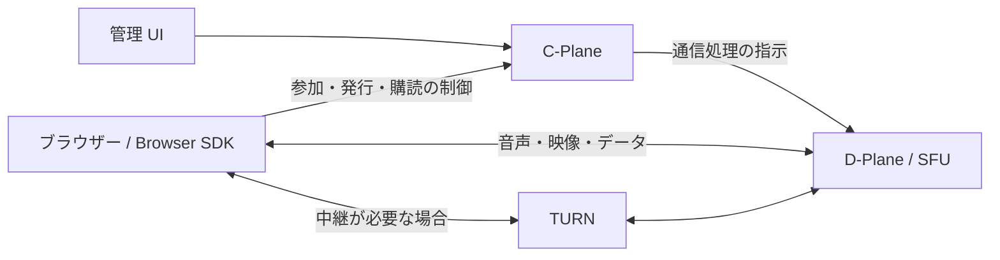

# WebRTC サーバープラットフォーム

## 前提

- ブラウザーから同じルームに参加し、音声・映像・データを送受信する。
- 通話はすべて SFU を経由する。P2P 通話は対象外とする。
- 1 ルームの同時参加人数は 100 人を目標とする。
- 全員がマイク・カメラを同時に有効にできる。
- 画面共有を提供する。
- 音声・カメラ映像・画面共有は PubSub 形式で転送する。
- 参加者は購読対象を変更できる。
- SFU を増設し、プラットフォーム全体の収容人数を増やせる構成にする。
- STUN、TURN、ICE / WebRTC Transport、SFU、SCTP / DataChannel のプロトコル処理と SFU の中核は Rust で実装する。
- アプリケーション制御、Signaling、Client SDK、管理 UI は TypeScript で実装する。
- 既存の WebRTC スタックや SFU 製品のラップはしない。
- 暗号など、安全性のために既存実装を利用する部分は各コンポーネントの仕様で定める。
- 録画や外部サービスへの配信を含めるかは、提供範囲の節で定める。

## 用語

| 用語 | 意味 |
|---|---|
| ルーム | 参加者が音声・映像・データを共有する単位 |
| 利用者 | 外部アプリケーションなどからプラットフォームを利用する人 |
| 参加者 | ルームに参加する利用者。ルーム内で参加者 ID により識別する |
| 参加端末 | Browser SDK を使ってルームに参加するブラウザー側の主体。同じ参加者の複数の参加端末を別々に扱い、個々の WebRTC 接続とは区別して識別する |
| SFU | 参加端末から受け取った音声・映像を、購読するほかの参加端末に転送するサーバー |
| Signaling | 参加や接続に必要な情報を交換する仕組み |
| Signaling 接続 | 参加端末と Signaling サーバーが制御情報を交換する接続。WebRTC 接続とは別に管理する |
| WebRTC 接続 | 参加端末と SFU が音声・映像・データを送受信する接続 |
| STUN | 接続に使う外部アドレスなどを確認するプロトコル |
| TURN | 直接到達できない相手への通信を中継する仕組み |
| Allocation | TURN がクライアントに割り当てる中継アドレスと関連状態。ルームへの SFU の割り当てとは別のもの |
| Permission | TURN が通信相手の IP アドレス単位で管理する中継用の状態。C-Plane が管理する利用権限とは別のもの |
| Channel Binding | TURN チャネル番号と通信相手の IP アドレス・ポートの対応 |
| ICE / WebRTC Transport | 参加端末と SFU の通信経路を選び、暗号化された通信を確立・維持するコンポーネント。本文では WebRTC Transport と呼ぶ |
| SCTP / DataChannel | SCTP と DataChannel の確立・配送・中継を処理するコンポーネント |
| SCTP Association | SCTP の通信状態を共有する接続関係。DTLS Association とは別に管理する |
| SCTP ストリーム | SCTP Association 内で識別される配送単位 |
| DataChannel | 参加端末と SFU の接続ごとに確立するデータ通信路 |
| 論理チャネル | ルーム内でメッセージの配送先・配送方式・権限などを管理する単位。接続ごとの DataChannel や SCTP ストリーム番号とは区別する |
| TURN チャネル | TURN のチャネル番号で識別し、Channel Binding によって通信相手の IP アドレス・ポートに対応付ける転送経路。DataChannel や論理チャネルとは別のもの |
| DTLS Association | DTLS の暗号状態を共有する接続関係。SCTP Association とは別に管理する |
| Client SDK | Browser SDK と、その基盤を利用する React SDK の総称 |
| Browser SDK | ブラウザーの WebRTC API を利用し、参加・退出・送受信を操作する TypeScript ライブラリ |
| React SDK | Browser SDK を基盤とし、Hooks・Context・コンポーネントなどを提供する React 向けライブラリ |
| 発行 | 参加端末が音声・カメラ映像・画面共有を、それぞれ SFU に送信すること。メディアの発行を指す場合に使い、トークンなどは「資格情報の発行」のように対象を明記する |
| 購読 | 参加端末が受信する発行済みの音声・映像を選ぶこと。状態変更の通知を受け取る操作は「通知購読」と呼ぶ |
| PubSub | 発行と購読を分け、SFU が購読関係に従って転送する方式 |
| C-Plane | 参加・権限・ルーム配置などを制御する部分 |
| D-Plane | 音声・映像・データの通信を処理する部分 |
| drain | SFU への新しいルーム割り当てを停止し、担当中のルームを継続・移行させて退役に進む運用状態 |

同じ概念には上記の名称を使い、対象が異なる「チャネル」「Association」「SDK」を単独の略称では記載しない。
認証・認可・資格情報と期限の用語は、[認証・認可・資格情報の用語](auth.md#用語)で定める。
各プロトコルのメッセージ名・属性名・API 名は、その仕様で使われる表記を維持する。

## 利用場面

主催者がルームを作り、参加者がブラウザーから参加する。
参加者はマイクとカメラを有効にする。
Browser SDK が Signaling を通じて接続情報を交換し、SFU への接続を確立する。
直接 SFU に到達できない参加者は TURN を経由する。

参加者は音声とカメラ映像を発行する。
各参加者は受信する音声・映像を購読する。
SFU が購読関係に従って転送する。
会議中に参加者が画面共有を発行し、他の参加者が購読する。
画面共有を終えると、その発行を終了する。
参加者は DataChannel でリアクションを共有する。

管理者は管理 UI でルームと接続状態を確認する。
参加者が参加端末から通常の退出を行うと、その参加端末の送受信を終了する。

## 提供範囲と対応クライアント

本プラットフォームは、ブラウザーから利用する音声・映像・データ通信を提供する。

- 参加者はルームに参加し、退出できる。
- 参加者は音声・カメラ映像・画面共有を発行し、受信するものを購読できる。
- 参加者は DataChannel でアプリケーションのデータを送受信できる。
- アプリケーション開発者は TypeScript の Browser SDK で参加・退出・送受信を制御できる。
- React アプリケーション向けに、Browser SDK を基盤とする React SDK を提供する。
- 管理者は管理 UI でルームと接続状態を確認できる。

対応クライアントは、デスクトップ版の Chrome・Firefox・Safari とする。
対応バージョンは受け入れ条件で定める。

Browser SDK の Node.js での動作は現時点では保証しない。
React Native、Python、Go などの SDK は将来の拡張候補とし、今回の対応範囲と共通実装の要件には含めない。

録画と外部サービスへの配信は今回の対象外とし、今後の拡張とする。

## 全体構成

サーバーを C-Plane と D-Plane に分ける。
論理的な責務を分離し、独立して増設できる構成とする。
実行プロセスの分離は必須としない。
Rust の実行方式は Wasm、Native Addon、独立 Worker を選択肢として残し、後続の技術選定で決定する。

| 部分 | 実装言語 | 責務 |
|---|---|---|
| C-Plane | TypeScript | ルーム管理、参加・権限の確認、Signaling、発行・購読の制御、接続先 SFU の割り当て、管理 UI への情報提供 |
| D-Plane | Rust | STUN、TURN、ICE / WebRTC Transport、SFU、SCTP / DataChannel の通信処理 |

Client SDK と管理 UI は C-Plane を通じて操作する。
C-Plane は権限を確認し、必要な処理を D-Plane に指示する。

Browser SDK を利用するブラウザーは、割り当てられた SFU と音声・映像・データを送受信する。
直接到達できない場合は TURN を経由する。
これらの通信は C-Plane を経由しない。

通常時は、参加者がいるルームを 1 つの SFU に割り当てる。
同じルームの参加者は、その SFU に接続する。
計画的な移行中は、新旧 SFU の併用を許す。
1 つの SFU に複数のルームを配置できる。

SFU を増設したときは、新しく配置するルームを増設先にも割り当てる。
稼働中のルームの移動と、SFU 障害時の再配置は、[SFU のスケール](sfu.md#sfu-のスケール)で定める。

## ルーム・参加者・権限

ルームはルーム ID で識別する。
参加者は、ルーム内で一意の参加者 ID で識別する。
同じ参加者の複数の参加端末を区別し、接続の再確立だけで別の参加端末として登録しない。

ルーム管理の権限を持つ呼び出し元が、ルームを作成・削除できる。
ルームは明示的に削除するまで保持する。
ルームを削除すると、参加中の全員の通信を終了する。

ルーム作成時には、SFU 上の通信資源を確保しない。
最初の参加端末が参加すると、SFU を割り当てて通信資源を確保する。
最後の参加端末が退出すると、通信資源を解放し、SFU の割り当てを解除する。
再び参加端末が参加すると、SFU を改めて割り当てる。
以前と異なる SFU に配置される場合がある。
通信断を退出と判断するまでの猶予は、Signaling の再接続の節で定める。

通話時間の上限は、ルームごとに任意で設定できる。
未設定の場合は、時間による通話の終了を行わない。
通話時間は、空のルームに最初の参加端末が参加した時点から計測する。
途中参加・再接続・SFU 移行では、計測の起点を変更しない。
通話時間の上限と SFU の退役期限について、予告の初期値は期限到達の 60 秒前とする。
予告の時間は変更できる。
途中参加などで予告時刻を過ぎている場合は、その時点で Browser SDK へ通知する。
画面への表示方法は、Browser SDK を利用するアプリケーションが決める。
上限に達した場合は、全員の通話を終了し、通信資源を解放する。
ルーム情報は保持する。
Browser SDK は終了理由を通知し、自動再接続しない。

アプリケーションは、参加者に許可する操作を指定する。

| 権限 | 許可する操作 |
|---|---|
| 参加 | 指定されたルームへの参加 |
| 発行 | 自分の音声・カメラ映像・画面共有の発行 |
| 購読 | 同じルームで発行された音声・映像の購読 |
| データ送信 | 同じルームへの DataChannel によるデータ送信 |

これらの権限は個別に設定できる。
ルームを管理する権限は、参加者の権限とは別に扱う。

C-Plane は、信頼できるアプリケーション側から与えられた権限を確認する。
参加者が Client SDK の操作によって自分の権限を増やすことはできない。
許可されていない操作は拒否する。

通常の退出では、対象の参加端末の発行・購読・DataChannel の通信を終了する。
同じ参加者の別の参加端末を含め、ほかの参加端末の通信は継続する。
SFU の割り当て解除は、[Signaling の参加・退出](signaling.md#参加退出)で定める並行参加・再接続待ちの条件も確認して行う。

## 共通のセキュリティ条件

認証・認可・資格情報に共通する条件は、[認証・認可・資格情報](auth.md)で定める。

アプリケーションは、参加を許可するルーム・参加者・操作をサーバー側で指定する。
ブラウザーに、権限の発行や管理に使う秘密情報を渡さない。

C-Plane は認証と権限の確認を行う。
D-Plane は、許可された接続と操作だけを受け付ける。
SFU の移行先にも同じ権限を適用する。

通信は次のように保護する。

| 通信 | 保護 |
|---|---|
| Browser SDK・管理 UI・アプリケーションと C-Plane | TLS による暗号化と接続先の検証 |
| C-Plane と D-Plane | 相互の認証と通信の暗号化 |
| ブラウザーと SFU の音声・映像 | DTLS-SRTP |
| ブラウザーと SFU の DataChannel | DTLS |

TURN による中継には認証を必須とする。

音声・カメラ映像・画面共有は、RFC 9605 の SFrame で参加端末間を暗号化する。
DataChannel の本文も参加端末間で暗号化する。
DataChannel 本文の暗号化方式は、[E2EE・鍵管理](e2ee.md#datachannel-本文の保護)で定める。
C-Plane・D-Plane に、これらを復号する鍵を渡さない。
参加端末と SFU の間の通信も、上記の方式で保護する。

DTLS 1.2 と DTLS 1.3 に対応する。
双方が対応している場合は DTLS 1.3 を優先する。
到達性確認、ハンドシェイク、断片再構成、再送の条件は、[共通 DTLS 仕様](dtls.md)で定める。

鍵の配布・更新と参加端末の認証を組み合わせ、許可された参加端末だけが復号鍵を取得できるようにする。
参加端末の識別、鍵の正当性確認、配布・更新の条件は、[E2EE・鍵管理](e2ee.md)で定める。
Client SDK と Signaling の仕様は、この条件に従って操作・イベントとメッセージを定める。

SFU 移行時も参加端末間の暗号化を維持する。
同じ鍵で暗号化カウンターを巻き戻さない。

暗号アルゴリズム、暗号学的な乱数生成、TLS / DTLS、証明書検証には既存実装を利用する。
利用する実装は、各コンポーネントの仕様で定める。

秘密鍵・認証情報・音声・映像・DataChannel の本文をログへ出力しない。

### 資源管理

サーバーが保持する接続状態、処理待ち要求、タイマー、管理表、受信・再構成バッファには、件数と総メモリ量の上限を設ける。
上限は設定可能とする。

資源を確保する前に、利用者別・サーバー全体の必要な枠を予約する。
並行要求が同じ空き枠を重複して取得できないようにする。
予約済み・使用中・解放待ちの資源を上限に計上する。
予約から使用中への移行で、二重計上や計上の空白を生じさせない。

予約と確保した資源をそれぞれ識別する。
確保・解放・照合の結果が、その予約と資源に対するものか確認する。
途中で失敗した場合、確保していないことが確認できた枠は返却する。
確保済みの資源に対応する枠は、解放を確認してから返却する。

各状態には、有効期限または解放条件を定める。
期限切れの状態は利用せず、関連する資源を解放する。
解放が完了するまでは、件数と総メモリ量に計上する。

タイムアウトや完了通知の消失だけを理由に、資源を未確保・解放済みとして扱わない。
結果不明の予約枠は計上を維持する。
実際の資源と管理記録を照合し、確保・解放の結果を確定する。
管理記録自体が失われた場合は、影響する範囲の新規確保を停止し、記録の再構築または既存資源の解放を確認してから再開する。

結果不明の状態を、TTL 到達だけで削除して枠を返却しない。
照合・回収処理にも処理量と待機時間の上限を設ける。
結果不明を解消できない場合は、対象を新規割り当てから外し、運用者へ通知する。
隔離した資源を安全に回収・再初期化する手段を用意する。
資源ごとに、所有者と解放を確認する方法を定める。
Worker プロセスの終了によって回収する場合は、その終了と、所有していた資源の解放を確認してから対応する枠を返却する。
外部サービスや別プロセスに保持された資源は、その Worker の終了だけでは解放済みと扱わない。

遅延した通知や重複通知によって、枠を二重返却したり、再利用後の別の資源を解放したりしない。

認証済みの利用者にも資源上限を適用する。
利用者ごとの上限と、サーバー全体の上限を設ける。
制限対象と超過時の応答は、各プロトコルの仕様で定める。

送信元ごとのレート制限管理表には、次の条件を適用する。

- 最大件数と総メモリ量を設定できる。
- 最終利用からの TTL を設定し、期限切れの項目を削除する。
- 制限期間が残っている項目を TTL によって早期削除しない。
- 上限到達時は、期限切れ項目を回収する。空きがなければ新規登録を抑制し、登録を必要とする要求は処理しない。
- 項目の削除・再登録によって、サーバー全体の要求数・応答帯域の制限をリセットしない。

DTLS の到達性確認前に保持する計数情報も、この条件に従う。
DTLS Cookie のステートレス処理と、接続固有の状態を確保する条件は、共通 DTLS 仕様で定める。

ネットワーク側の送信元アドレスフィルタリングと、サーバー側の要求数・応答帯域制限を併用する。

受け入れ試験では、送信元の大量変更、並行要求、期限切れ、削除直後の再要求を含める。
保持状態とバッファが設定上限を超えず、項目の削除でサーバー全体の制限を回避できないことを確認する。

資源確保・解放の受け入れ試験には、次の条件を含める。

| 条件 | 確認する結果 |
|---|---|
| 空き枠 1 に対して複数の同時要求 | 確保できるのは最大 1 件 |
| 確保直後の完了通知を消失 | 未確保として再利用せず、照合で結果を確定する |
| 解放通知を消失・重複・遅延 | 過少計上や二重返却を起こさない |
| 管理記録の消失・復旧 | 整合確認前に新規確保を再開しない |
| 隔離した資源の所有 Worker を終了し、再初期化 | 解放を確認できた資源の枠を回収し、別の所有者の資源は解放済みと扱わない |
| 枠の再利用後に古い通知が到着 | 新しい予約と資源の状態を変更しない |

## 実装・検証の共通方針

正確性と保守性を重視し、コンポーネントの性質と失敗時の影響に応じて検証方法を選定する。
すべての関数に一律の形式検証を要求しない。

状態遷移、並行処理、認可、資源の確保・解放、鍵更新などには、TLA+ によるモデル検査を積極的に利用する。
安全性に加え、必要に応じて活性も検証する。
活性の成立に必要な実行の公平性、通信、障害回復などの前提を明示する。

数学的な不変条件やアルゴリズムの正しさには、Lean 4 などによる形式的な証明を検討する。
Rust 実装との対応を検証する手段として、Verus・Aeneas なども評価する。
これらの具体的な採用は、対象への適合性を確認して決定する。

パケット解析、状態遷移、入力検証などには、Fuzzing と Property-based Testing を利用する。
正常系だけでなく、異常入力、境界値、通知の欠落・重複・順序逆転、並行処理を重点的に検証する。

TypeScript と Rust の型検査・静的解析は、可能な範囲で厳格に設定する。
警告の抑制や検査の無効化を安易に認めない。
例外が必要な場合は、必要性、適用範囲、根拠を明確にする。

不要な抽象化、重複実装、過剰なファイル分割、意味のないコメントやドキュメントを増やさない。
呼び出し元から、主要な判断、実行順序、副作用、結果、失敗時の扱いを追えるようにする。
振る舞いと変更理由を追えるようにし、コードから読み取れる処理の言い換えをコメントとして増やさない。

検証結果は、次を区別して記録する。

| 検証方法 | 明示する範囲 |
|---|---|
| 数学モデルの検査 | モデル化した状態・遷移、検査した性質、状態空間の制限と実行上の前提 |
| 数学的な証明 | 証明した命題、定義、使用した公理・仮定と未証明の事項 |
| 実装コードの形式検証 | 対象コード、契約、検証した性質、検証対象外の処理と信頼する部分 |
| Fuzzing・Property-based Testing・その他のテスト | 入力・操作列の範囲、判定条件、実行条件と結果 |
| 静的解析 | 対象コード、適用した検査、設定、警告抑制や無効化した検査 |

各検証について、対象要件、前提、検証範囲、対象外とその理由を明示する。
数学モデルの状態・遷移が実装のどの処理に対応するかを確認する。
モデル検査や証明が成功したことだけを理由に、実装まで正しいとは判断しない。

数学モデル、証明、検証コードと設定自体の妥当性も確認する。
TLA+ のモデルが、仕様に必要な状態・遷移と、検証する性質に関係する並行処理・障害条件を表現していることを確認する。
Lean 4 などの証明では、公理・仮定の必要性と適用範囲を確認し、不要な公理や結論を先取りする仮定によって証明を成立させない。
未証明の事項を、証明済みとして扱わない。
テストの入力生成、期待結果、判定条件と検査設定が、対象要件を実際に検査していることを確認する。
必要な遷移を到達不能にする前提、成立しない事前条件、無効化された判定などによって、検査が実質的に行われず成功していないことを確認する。
検証ツールの成功報告とは別に、モデル・証明・検証コード・設定の妥当性を確認する。

形式検証や静的解析を通過させるために、本来必要な機能・セキュリティ要件を削除したり、検証対象を不当に狭めたりしない。
検証対象や前提を限定する場合は、その制約を明示し、範囲外の要件を検証済みとして扱わない。

選定した検証は、CI で再現・継続実行できる構成を重視する。
実行時間に応じて、変更時に行う検査と定期的に行う検査を分ける。
ツールのバージョン、設定、実行範囲、再現に必要な条件と結果を記録する。
未実行、時間切れ、検証不能を成功と区別する。
仕様・モデル・実装・検証設定の変更時には、影響する検証と対応関係を再確認する。

## 収容人数・品質・受け入れ条件

1 ルームの同時参加人数は 100 人を目標とする。
収容人数は、発行・購読・暗号化の条件を固定して測定する。

基準となる試験条件を次のとおりとする。

| 項目 | 条件 |
|---|---|
| 参加者数 | 100 人 |
| 音声・カメラ映像 | 全員が同時に発行 |
| カメラ映像 | 720p・30 fps |
| 映像の購読 | 各参加者が他の 9 人を購読 |
| 画面共有 | 1 人が 1080p・15 fps で発行し、他の全員が購読 |
| E2EE | 音声・映像・DataChannel で有効 |

この条件は性能測定の基準とする。
製品としての購読数や画面共有数の上限は、SFU の仕様で定める。

測定結果には、サーバー構成、参加端末・ブラウザー、コーデック、ビットレート、音声の購読数、DataChannel の通信量、TURN 経由の割合を記録する。

CPU・メモリ・送受信帯域、音声・映像の遅延と欠落、切断回数を測定する。
100 人に届かない場合も、同じ条件で収容できた人数を記録する。

Chrome・Firefox・Safari 間の送受信を確認する。
DTLS 1.2 と 1.3 は、それぞれ対応する接続相手との試験を行う。

SFU 移行では、暗号化を維持した切り替えと、退役期限での自動再接続を確認する。
移行中の音声・映像の中断時間と、DataChannel の欠落・重複を測定する。
各測定値の合否基準は、コンポーネントごとの受け入れ条件で定める。

## コンポーネント仕様

- [認証・認可・資格情報](auth.md)
- [STUN サーバー](stun.md)
- [TURN サーバー](turn.md)
- [共通 DTLS](dtls.md)
- [E2EE・鍵管理](e2ee.md)
- [Signaling サーバー](signaling.md)
- [ICE / WebRTC Transport](transport.md)
- [SFU](sfu.md)
- [SCTP / DataChannel](datachannel.md)
- [Browser SDK / React SDK](client-sdk.md)
- [管理 UI](admin-ui.md)
